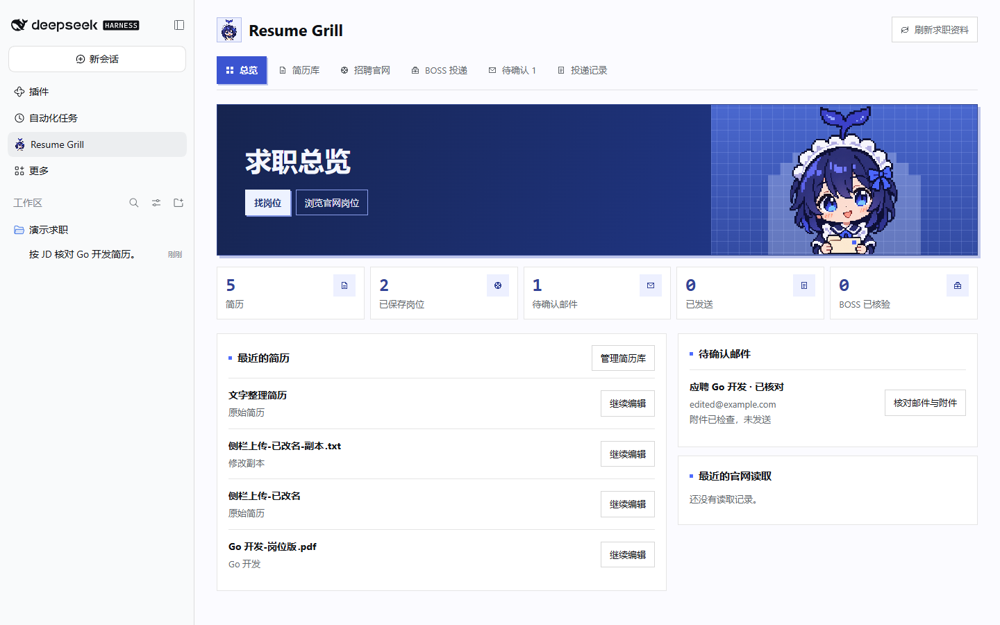
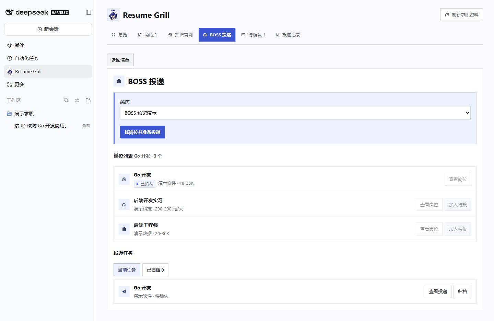

<p align="center">
  
</p>

<h1 align="center">Resume Grill</h1>

<p align="center">
  一个 DSH 求职插件。在工作台里找岗位、按 JD 修改简历、准备投递，简历和记录保存在本机。也提供 <a href="docs/mcp.md">MCP 接口</a>。
</p>

<p align="center">
  
  
  
  
  
  
  <a href="https://linux.do/"></a>
</p>



## 功能

| 入口 | 可以做什么 |
| --- | --- |
| 简历库 | 导入 PDF、DOCX、TXT 或 Markdown，查看原文件、编辑另存、管理版本和回收站。 |
| 招聘官网 | 读取公司官网岗位，按 JD 核对简历；可打开官网手动申请。 |
| BOSS 投递 | 用内置执行器连接本机 ego、Edge 或 Chrome，按简历搜索和筛选岗位。自动发招呼与简历图片为实验功能。 |
| 邮箱投递 | 选简历、填收件邮箱即可预览，用 QQ、163 或 126 邮箱确认发送。也可按岗位整理草稿。 |
| 官网代填 | 从岗位卡片打开官网，用已确认的资料填写申请表、附上所选简历，回读后由你在官网提交。[使用说明](docs/browser-forms.md) |
| 投递记录 | 一起查看 BOSS、官网和邮件记录，标记进展、跟进日期，筛出已到期的事项。 |

### 按岗位改简历

打开岗位 JD，勾选要采纳的修改，也可以手动改正文。保留原文时沿用原 PDF，改写后另存分节版式的岗位 PDF。[查看简历核对截图](docs/screenshots/dsh-job-review.png)

### BOSS 投递

在 **Resume Grill → BOSS 投递** 选主简历和招聘类型（实习、校招、全职），点「找岗位并准备投递」。插件从当前页最多核对 10 份完整 JD，准备符合条件的岗位。缺少依据的岗位可在列表里查看。核对前可增减岗位、换简历或调整顺序。[BOSS 使用说明](docs/boss.md)



## 安装

在 DSH 打开 **插件 → 添加插件 → 安装第三方插件**，填写预构建 `.tgz` 的绝对路径，启用「Resume Grill」。

当前可从本仓库生成安装包，需要 Node.js 24+：

```sh
npm ci
npm run package:plugin
```

终端会给出 `artifacts/` 下的插件包路径。安装后从 DSH 左侧打开 **Resume Grill**。详见 [DSH 安装说明](docs/dsh.md)。

<details>
<summary>让 AI 安装</summary>

把下面的提示词复制给能在你本机运行终端命令的 AI 助手。

```text
请把 Resume Grill 安装到我本机的 DSH 桌面版。
源码仓库 https://github.com/MIU-MA/resume-grill-agent

1. 优先用我提供的 .tgz。没有安装包时，用本地已有源码或克隆仓库。
   确认 Node.js 24+，在仓库目录运行 npm ci 和 npm run package:plugin。
2. 使用实际 .tgz 路径运行 dsh plugin --profile desktop add "<.tgz 绝对路径>"。
   dsh 不在 PATH 时查找桌面版自带的 CLI。若无法调用 CLI，把包的绝对路径给我，
   我会粘贴到 DSH 的「安装第三方插件」。
3. 告诉我安装结果。若 DSH 已在运行，请提醒我完全退出并重新打开，
   然后从左侧打开 Resume Grill。做到安装这一步就可以了。
```

</details>

## 开发

`npm run check` 检查类型，`npm test` 运行 `tests/` 中的测试。GitHub CI 也会运行这些测试，安装包会排除该目录。[开发说明](docs/development.md) · [来源与许可](THIRD_PARTY.md)
