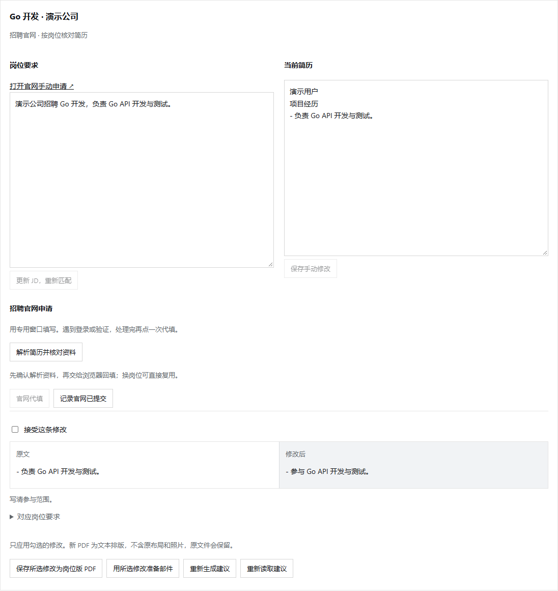

# 鲸历 · Resume Grill Agent

一个 DSH 求职插件。在工作台里找岗位、按 JD 修改简历、准备投递，简历和记录保存在本机。也提供 [MCP 接口](docs/mcp.md)。


## 安装

在 DSH 打开 **插件 → 添加插件 → 安装第三方插件**，填写预构建 `.tgz` 的绝对路径，启用「鲸历」。

当前可从本仓库生成安装包，需要 Node.js 24+：

```sh
npm ci
npm run package:plugin
```

终端会给出 `artifacts/` 下的插件包路径。安装后从 DSH 左侧打开 **鲸历**。详见 [DSH 安装说明](docs/dsh.md)。

## 功能

| 入口 | 可以做什么 |
| --- | --- |
| 简历库 | 导入 PDF、DOCX、TXT 或 Markdown，查看原文件、编辑另存、管理版本和回收站。 |
| 招聘官网 | 读取公司官网岗位，按 JD 核对简历；可打开官网手动申请。 |
| BOSS 投递 | 用内置执行器连接本机 ego、Edge 或 Chrome，按简历搜索、准备附件，核对后投递。不需要招聘浏览器 MCP。 |
| 邮件 | 用 QQ、163 或 126 邮箱发送。可批量整理草稿，发送前核对收件人、正文及附件。 |
| 官网代填 | 从岗位卡片打开官网，用已确认的资料填写申请表、附上所选简历，回读后由你在官网提交。[使用说明](docs/browser-forms.md) |

### 按岗位改简历

打开岗位 JD，勾选要采纳的修改，也可以手动改正文。原简历保留，新的岗位版 PDF 采用文本排版。



### BOSS 投递

在 **鲸历 → BOSS 投递** 选主简历，点「找岗位并准备投递」。插件搜索、读 JD，并用选定的简历准备最多 3 个岗位，核对后一次确认投递。[BOSS 使用说明](docs/boss.md)


## 开发

TypeScript · React · SQLite · MCP

`npm run check` 检查类型，`npm test` 运行测试。[开发说明](docs/development.md) · [来源与许可](THIRD_PARTY.md)
